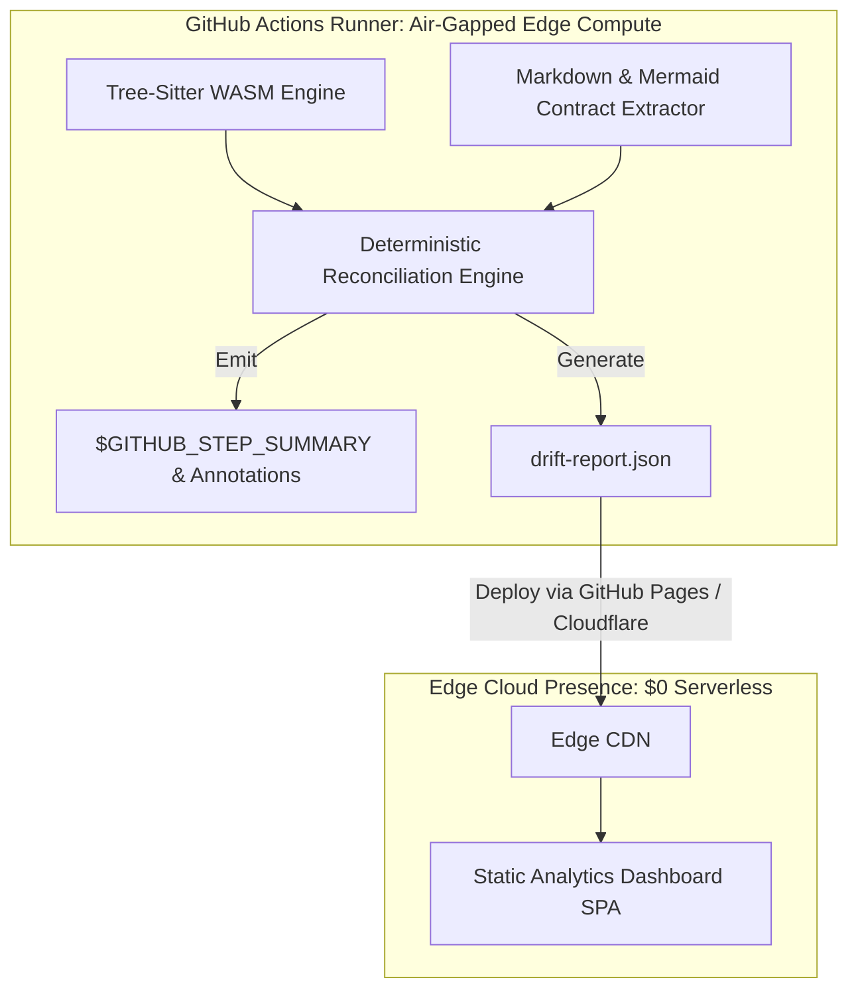

# DocPulse Concepts Brief: Living Documentation System

**Document Type:** EGM Brainstorm Synthesis & Architecture Concept Brief  
**Project:** DocPulse (CI-Integrated Living Documentation System)  
**Target:** B.Tech CSE Capstone (Team of 3, ~10 Weeks, $0 Hosting Budget)  
**Status:** Approved for Design Specification Drafting  

---

## 1. Executive Summary & Problem Definition

Software documentation invariably drifts from code reality. When API parameters change, functions are renamed, or system components are refactored, architectural diagrams, README guides, and API tables fall out of sync. Traditional remedies fail in opposite directions:
- **Docstring generators** (e.g., Sphinx, TypeDoc) extract comments local to source files but cannot maintain high-level architecture documents, sequence diagrams, or repository READMEs.
- **Linters** (e.g., Vale, markdownlint) enforce prose style and syntax but are completely blind to code symbol tables.
- **Proprietary SaaS** (e.g., Swimm) requires vendor lock-in, external code exfiltration, and paid subscription plans unsuitable for open-source or compliance-sensitive environments.

**DocPulse** is an open-source, air-gapped, CI-native living documentation gate and reconciliation engine. Running directly on the user's ephemeral GitHub Actions runner without external servers or databases, it treats documentation as **testable assertions against the code's Abstract Syntax Tree (AST)**.

---

## 2. Adversarial Analysis & Genuinely Novel Contribution (Q1)

### 2.1 The Naive Pitch vs. Reality
The naive concept of extracting arbitrary "claims" from unstructured Markdown prose using regex or unconstrained LLMs is fundamentally flawed:
1. Regex heuristics break on natural human phrasing variations.
2. In-CI LLM evaluation introduces latency (15–45s per PR), non-deterministic test flakiness (violating the core rule of CI/CD), and external token costs.

### 2.2 Competitive Differentiation Matrix

| Tool Category | Examples | Operating Model | What It Lacks / How DocPulse Wins |
|---|---|---|---|
| **Docs-as-Code Linters** | Vale, markdownlint, alex | AST of Markdown | Zero code awareness; cannot detect that a referenced function or endpoint was deleted. |
| **Schema Generators** | FastAPI/Swagger, tsoa | Code reflection / runtime | Only covers REST schemas; completely ignores Markdown guides, sequence charts, and architectural diagrams. |
| **Doc Platforms** | Mintlify, Readme.com | Hosted SaaS | Hosted documentation sites; do not perform automated CI drift enforcement on existing markdown files. |
| **Code-Coupled Docs** | Swimm | Proprietary SaaS | Requires external SaaS account, proprietary IDE plugins, and exfiltrates code context outside the user's secure perimeter. |
| **Doc Bots** | Copilot PR, CodeRabbit | Hosted LLM Agents | Generates prose reviews; does not provide deterministic pass/fail CI gates, idempotent marker syncing, or mathematical staleness metrics. |

### 2.3 The Defensible Novelty
DocPulse establishes two distinct, verifiable technical novelties:
1. **Deterministic Structural Contract Verification**:
   - Matches explicit documentation anchors (e.g., code-spans `` `module.function` ``, parameter tables, and typed markers) against the codebase AST symbol table using Tree-sitter.
   - **Executable Mermaid Verification**: Treats embedded Mermaid diagrams as directed graphs (adjacency matrices) and validates their edges against the AST module import graph and route call graph.
2. **Zero-Trust, Air-Gapped CI Telemetry**:
   - Operates 100% locally within ephemeral runners without external SaaS dependencies. Telemetry is persisted directly via git-native artifacts (`docpulse-data` or Pages artifacts), ensuring zero compliance or hosting overhead.

---

## 3. Top Technical and Scope Risks (Q2)

1. **Fatal Risk 1: Multi-Language AST Bloat (Python + TypeScript)**
   - *Risk:* Supporting both Python and TypeScript with native runtimes creates fragile cross-compilation issues, massive Docker images, and double the parser query maintenance.
   - *Mitigation:* Use **Tree-sitter WASM (`web-tree-sitter`)** bundled via a single Node.js runtime or unified Python `tree-sitter-languages`. A single runtime parses both Python and TypeScript grammars with zero native gcc/clang toolchain requirements.
2. **Fatal Risk 2: CI Write-Back Feedback Loops & Permission Traps**
   - *Risk:* Auto-committing marker changes inside a GitHub Action can cause infinite CI triggering loops (`push -> action -> push`) or crash with `HTTP 403` on fork PRs or protected branches.
   - *Mitigation:*
     - On PRs: Strictly read-only analysis emitting `$GITHUB_STEP_SUMMARY` and review annotations (zero write permissions required; 100% fork-safe).
     - On Default Branch `push`: Idempotent marker sync committing with explicit `[skip ci]` metadata and author checks (`github.actor != 'docpulse-bot'`).
3. **Fatal Risk 3: Non-Deterministic CI Gating**
   - *Risk:* Using generative LLMs to decide build pass/fail causes intermittent CI failures.
   - *Mitigation:* **Two-phase pipeline**: Phase 1 (Deterministic AST Gatekeeper) is 100% rule-based and controls the exit code ($0$ or $1$). Phase 2 (Remediation Advice) is purely advisory and rendered as non-blocking PR comments or patch files.

---

## 4. Cloud Deployment Strategy for Capstone Evaluators (Q3)

Academic capstone evaluators frequently demand evidence of "cloud deployment" and may question a pure GitHub Action. To satisfy this criterion without incurring hosting costs or operational maintenance during grading demos, DocPulse provides two complementary architectural perspectives:



1. **The Primary "Air-Gapped Enterprise Security" Thesis**:
   - Defend the architecture affirmatively: *"DocPulse is intentionally designed as a zero-egress, air-gapped CI system. Enterprise intellectual property and source code never leave the customer's isolated runner environment."*
2. **Serverless Static Cloud Dashboard (GitHub Pages)**:
   - Evaluator-facing cloud presence is delivered via a Single Page Application (Vite/React/Tailwind) hosted on GitHub Pages. It visualizes historical documentation health curves, drift timelines, and module staleness distributions without requiring a backend server.
3. **Local Interactive CLI (`docpulse serve`)**:
   - For live viva demonstrations, a built-in CLI command serves the dashboard locally via Python/Node, ensuring zero dependence on external network availability during defense sessions.

---

## 5. Innovation Feature Audit: Value vs. Risk Matrix (Q4)

| Feature | Effort | ROI / Academic Value | Final Verdict | Technical Rationale |
|---|:---:|:---:|:---:|---|
| **AST Symbol & Signature Resolver** | Low | **High** | **CORE MVP** | Deterministic detection of parameter changes, renames, and deletions. Foundational to the project. |
| **Deterministic Marker Synchronization** | Med | **High** | **CORE MVP** | `<!-- docpulse:start signature:func -->` envelope sync. High utility, zero hallucination. |
| **CI Summary & Visual Annotations** | Low | **High** | **CORE MVP** | Native `$GITHUB_STEP_SUMMARY` Markdown table + inline line annotations on PR diffs. |
| **Graph-Distance Staleness Scoring** | Med | **High** | **CORE MVP** | Mathematical score ($0.0 - 1.0$) based on AST distance between changed code and doc references. Defensible academic rigor. |
| **Mermaid Import/Call Graph Sync** | Med | **High** | **CORE (P1)** | Parses Mermaid flowcharts/sequence diagrams into adjacency graphs; matches against AST imports. Visually impressive for capstone demos. |
| **Static Metrics Dashboard (Pages)** | Med | **High** | **CORE (P1)** | Demonstrates historical trends and repository doc health score over time. |
| **Extractive Diff Summaries** | Med | **Low** | **DE-PRIORITIZE** | Generic PR diff summarization is a commodity already saturated by Copilot/CodeRabbit. |
| **ADR Suggestion Engine** | High | **Low** | **CUT** | Inferring when an architectural change requires an ADR is subjective and generates high false-positive noise. |
| **LLM Prose Auto-Rewrite** | High | **Low** | **CUT FROM CI** | Non-deterministic, slow, prone to hallucinations, and risks corrupting technical prose. |

---

## 6. Grader-Defensible Evaluation Strategy (Q5)

To provide an irrefutable academic evaluation, DocPulse will be assessed using a **dual-dataset methodology** evaluated against a formal baseline:

### 6.1 Evaluation Methodology
1. **Synthetic Mutation Benchmark (DocMutation)**:
   - A curated test corpus of **50 systematic mutations** injected across 3 open-source repositories:
     - 20 Signature Drifts (parameter added, removed, type altered, renamed).
     - 10 Structural Drifts (function deleted, class method relocated, module split).
     - 10 Mermaid Diagram Inconsistencies (node call edge missing or invalid).
     - 10 In-Sync Control Cases (asserting **0% False Positive Rate** on valid docs).
2. **Empirical Mining of Real-World Repositories**:
   - Analyze historical commit logs of 5 high-star FastAPI and TypeScript repositories (e.g., SQLModel, FastAPI-Users).
   - Identify commits that altered function signatures and locate the subsequent commit that updated documentation.
   - Measure **Mean Time to Detect (MTTD)**: Compare the historical lag (days between code commit and doc fix) against DocPulse's instantaneous detection at PR creation ($0$ days).
3. **Ablation Baseline Comparison**:
   - Compare DocPulse against:
     - **Baseline A**: Naive Regex/Keyword matching (showing high false-positive rate).
     - **Baseline B**: Unconstrained LLM prompt ("Check if this diff breaks docs", showing latency and token cost).
     - **DocPulse**: Deterministic AST contract matcher (demonstrating $>95\%$ Precision, $>90\%$ Recall, and $<3\text{s}$ CI overhead).

---

## 7. Scope Pruning: What Is Cut (Q6)

To guarantee that 3 engineers can deliver a production-grade, fully tested system within 10 weeks, the following items are formally eliminated:

1. **NO Persistent Backend Web Server**: Eliminate any standalone FastAPI or Express backend service in CI. DocPulse executes as a CLI binary and GitHub Action.
2. **NO Unstructured Natural Language Claim Extraction**: We do not parse freeform English prose into formal logic. We inspect explicit semantic anchors: code-spans (`` `auth.login` ``), parameter tables, and marker blocks.
3. **NO In-CI LLM Dependency**: Core drift detection and marker replacement must operate with 0 external API calls and $0 token cost. Optional LLM capabilities are isolated to an off-line advisory script.
4. **NO Direct Commits on External PRs**: All pull request checks are strictly advisory via summaries and annotations. Direct writes are restricted to default branch pushes.

---

## 8. 3-Person Team Ownership & Viva Defense Strategy

The project is decoupled along a frozen interface schema: `drift-report.schema.json`. Each team member owns a self-contained, defensible subsystem for the viva examination:

```
[Student 1: Core Analyzer] ---> (drift-report.schema.json) ---> [Student 2: Action Runtime]
                                           |
                                           v
                              [Student 3: Dashboard & Benchmarks]
```

### Student 1: Core Static Analysis & Grammar Engine Lead
- **Viva Focus**: Compiler theory, Tree-sitter AST queries, multi-language grammar parsing, graph extraction from Mermaid diagrams, false-positive elimination.
- **Owned Modules**: `/core/analyzer`, `/core/parsers`, `/core/matcher`.
- **Primary Viva Defense**: *"How does the AST extractor handle dynamic typing in Python versus TypeScript interfaces without executing untrusted code?"*

### Student 2: Action Runtime & Idempotent Reconciliation Lead
- **Viva Focus**: CI/CD systems engineering, GitHub Actions execution lifecycle, fork security boundaries, mathematical idempotency of marker reconciliation.
- **Owned Modules**: `/action`, `/core/reconciler`, workflow templates.
- **Primary Viva Defense**: *"How do you prevent infinite CI feedback loops and handle read-only GITHUB_TOKEN restrictions on forked pull requests?"*

### Student 3: Observability, Metrics & Empirical Benchmarking Lead
- **Viva Focus**: Empirical software engineering, benchmark dataset design, statistical evaluation (Precision/Recall/F1), static dashboard architecture.
- **Owned Modules**: `/benchmarks`, `/dashboard`, evaluation report generator.
- **Primary Viva Defense**: *"How did you validate that your synthetic mutation benchmark reflects real-world developer documentation drift?"*

---

## 9. 10-Week Execution Roadmap

| Milestone | Weeks | Primary Objectives | Deliverable & Exit Gate |
|---|:---:|---|---|
| **Phase 0: Spikes** | W1–W2 | • Freeze `drift-report.schema.json`<br>• Spike Tree-sitter WASM packaging in GitHub Actions<br>• Verify fork PR security and step summaries | End-to-end hello-world Action running on `ubuntu-latest` in $<5\text{s}$. |
| **Phase 1: Core Alpha** | W3–W5 | • Python & TypeScript AST extractors<br>• Markdown marker reconciler with idempotency tests<br>• Local CLI (`docpulse check`) | **Milestone: Alpha Release.** CLI accurately flags signature drift on local test fixtures. |
| **Phase 2: CI Integration** | W6–W7 | • GitHub Action packaging with `$GITHUB_STEP_SUMMARY`<br>• Inline PR warning annotations<br>• Opt-in `[skip ci]` auto-commit mode | **Milestone: Beta Release.** Action runs in real PRs and outputs formatted drift tables. |
| **Phase 3: Observability & Eval** | W8–W9 | • Static Vite/React dashboard deployed to GitHub Pages<br>• Run 50-case DocMutation benchmark suite<br>• Calculate empirical MTTD on open-source repos | Dashboard live on Pages; benchmark results table generated. |
| **Phase 4: Lockdown & Viva** | W10 | • Feature freeze & bug fixing<br>• Capstone evaluation paper drafting<br>• Live viva demonstration rehearsal | Fully green test suite, reproducible demo repository, and final report. |
