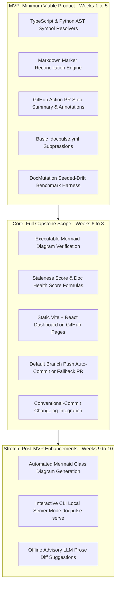
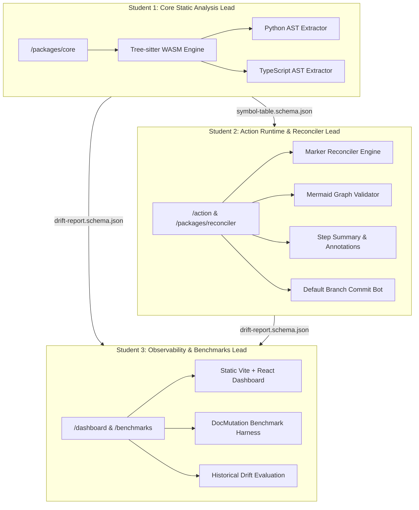

# Design Document: Problem Statement, Personas & System Scope

**Document Identifier:** `DOCS-DESIGNS-001`  
**Status:** DRAFT (Post EGM-Review Revision)  
**Authors:** DocPulse Capstone Team  
**Reviewers:** Elephant-Goldfish Review Swarm (`egm-structural`, `egm-style`, `egm-comprehension`, `egm-design`)  
**Date:** 2026-11-21  
**Target Repository:** `docpulse` (Monorepo)  

---

## 1. Problem Statement

### 1.1 The Context of Documentation Drift
In modern software engineering, codebases evolve rapidly through Continuous Integration (CI) and Continuous Delivery/Deployment (CD) workflows, but documentation updates remain manual, asynchronous, and voluntary [Verifiable: empirical software engineering literature on doc drift]. When engineers rename function parameters, alter Representational State Transfer (REST) API schemas, update return types, or refactor system module interactions, accompanying documentation—such as repository READMEs, API parameter tables, and architecture diagrams—invariably falls out of sync.

Documentation drift manifests in two primary forms:
1. **Mechanical Drift**: Syntactic discrepancies where referenced function signatures, parameter names, type annotations, or route paths in documentation diverge from the codebase symbol table.
2. **Structural / Architectural Drift**: Topological discrepancies where architecture diagrams (e.g., Mermaid flowcharts and sequence charts) depict outdated module dependencies, removed components, or deprecated call sequences.

### 1.2 Failure of Existing Review Processes
Peer code review processes (e.g., GitHub Pull Request [PR] reviews) systematically fail to prevent documentation drift [Verifiable: code review empirical studies on doc maintenance]:
- Reviewers focus predominantly on business logic, edge cases, performance, and automated test pass rates.
- Documentation reviews are treated as secondary concerns or deferred to post-release tasks that are rarely prioritized.
- Manual cross-checking of code diffs against distributed documentation files is labor-intensive and cognitively demanding for human reviewers.

### 1.3 Downstream Consequences
When documentation drifts from code reality, engineering teams incur measurable penalties [Verifiable: developer onboarding friction metrics]:
- **Increased Onboarding Latency**: New team members write code against stale examples or broken API signatures.
- **Integration Defects**: Internal and external developers integrate against outdated parameter tables and invalid endpoints.
- **Erosion of Documentation Trust**: When engineers encounter incorrect documentation, they abandon documentation entirely and resort to reverse-engineering raw source code.

---

## 2. Personas

### 2.1 Persona 1: The Feature Engineer ("Author")
- **Profile**: A full-stack or backend engineer making frequent daily commits and opening pull requests.
- **Needs**: Immediate, actionable feedback on whether code modifications broke documented signatures. Zero friction or slowdown in the CI feedback loop.
- **Pain Points**: Subject to high friction from manual signature updates; sensitive to false-positive CI noise that blocks merges.

### 2.2 Persona 2: The Repository Maintainer / Tech Lead ("Reviewer")
- **Profile**: Tech lead or open-source maintainer responsible for repository health, API stability, and PR merges.
- **Needs**: High-confidence, deterministic validation that incoming PRs do not silently invalidate public documentation or architecture diagrams. Clean, sticky PR summaries (on internal branches) or GitHub Step Summaries and line annotations (on external fork PRs) that highlight drift without cluttering git commit history.
- **Pain Points**: Managing untrusted pull requests from external forks where CI write permissions are restricted. Insufficient review capacity to manually verify Mermaid diagrams against code import graphs.

### 2.3 Persona 3: The Platform & Security Engineer ("Governor")
- **Profile**: Platform administrator responsible for CI/CD governance, developer tooling security, and infrastructure costs.
- **Needs**: **Zero third-party egress** [Verifiable: runner-contained execution]. Assurance that intellectual property, proprietary source code, and secrets are never exfiltrated to external SaaS platforms or third-party Large Language Model (LLM) providers. Zero ongoing cloud infrastructure hosting costs ($0 budget).
- **Pain Points**: Multi-tenant SaaS documentation tools requiring elevated repository write access, external webhook configurations, and costly monthly per-seat licensing.

---

## 3. Goals and Non-Goals

### 3.1 Goals
1. **Deterministic Static AST Contract Verification**: Provide a pure static analysis gate using Tree-sitter WebAssembly (`web-tree-sitter` WASM) that extracts symbol tables from Python (FastAPI) and TypeScript codebases and validates them against explicit documentation references without executing untrusted runtime code [Verifiable: AST tree comparison].
2. **Two-Phase Gating Pipeline**:
   - **Phase 1 (Deterministic AST Gate)**: Enforces objective checks (parameter names, types, route signatures, and Mermaid import edges). Mismatches exit with a non-zero exit code to fail the CI check [Verifiable: deterministic process exit codes].
   - **Phase 2 (Advisory Output)**: Emits rich Markdown tables to `$GITHUB_STEP_SUMMARY`, inline workflow annotations, and non-blocking documentation pull requests for prose drift without blocking CI builds [Verifiable: GitHub Actions workflow output].
3. **Executable Mermaid Diagram Synchronization**: Validate that embedded Mermaid flowcharts (`flowchart TD/LR`) match actual codebase import graphs via explicit `%% docpulse:module=` mappings [Verifiable: AST import graph containment].
4. **Zero Third-Party Egress & Fork Safety**: Execute entirely within the user's ephemeral GitHub Actions runner. On forked pull requests, operate in a strictly read-only mode emitting `$GITHUB_STEP_SUMMARY` Markdown tables and workflow warning annotations without requiring repository secrets or write permissions [Verifiable: GitHub Actions security model].
5. **Idempotent Marker Block Synchronization**: On default-branch pushes, automatically regenerate marked documentation blocks using a mathematically idempotent reconciler, committing with `[skip ci]` metadata and bot actor guards [Verifiable: idempotent regex replacement].
6. **Continuous Telemetry & Observability**: Persist structured JSON drift findings (`drift-report.schema.json`) to the `docpulse-data` branch and visualize repository Doc Health Scores and staleness trends on a static GitHub Pages dashboard [Verifiable: git tree commit schema validation].
7. **Configurable Governance**: Support `.docpulse.yml` configuration allowing engineering teams to define inspection paths, exclude files, and manage baselines/suppressions [Verifiable: YAML schema validation].

### 3.2 Non-Goals
1. **Generative Natural Language Prose Drafting**: DocPulse will not attempt to write or rewrite creative prose paragraphs from scratch. Prose changes beyond deterministic marker blocks are strictly advisory and never silently rewritten [Assumption: generative prose in CI introduces hallucination risk].
2. **Unstructured NLP Claim Extraction**: DocPulse will not use regex heuristics or unconstrained Natural Language Processing (NLP) / LLMs to convert arbitrary English prose into formal logic claims. Verification is strictly anchored to code spans (`` `module.symbol` ``), parameter tables, and explicit markers.
3. **Persistent Cloud Server / Database Hosting**: DocPulse will not deploy or maintain an external backend web server (e.g., persistent FastAPI or Express VM) or cloud SQL database. All persistence is git-native.
4. **General-Purpose Documentation Hosting**: DocPulse is not a static documentation site generator (such as Docusaurus, MkDocs, or Mintlify); it is a CI-integrated validation and synchronization gate.
5. **Bidirectional Code Modification**: DocPulse treats source code as the authoritative ground truth. It will never modify source code to match documentation.

---

## 4. Novelty and Competitive Analysis

### 4.1 Competitive Differentiation Matrix

| Dimension | Docs-as-Code Linters (Vale, markdownlint) | Code-Coupled Docs (Swimm) | Hosted Doc Sites (Mintlify, GitBook) | Docstring Extractors (Sphinx, TypeDoc) | Generative Doc Bots (Copilot, CodeRabbit) | **DocPulse (Our System)** |
|---|---|---|---|---|---|---|
| **Underlying Analysis** | Markdown AST (syntax/prose style) | Proprietary token anchors & IDE plugins | Markdown rendering & search indexing | AST / Runtime code reflection | LLM prompt over git diff | **Tree-sitter WASM AST + Markdown Contracts** |
| **Code Awareness** | None (blind to code symbols) | Deep (code-coupled tokens) | None (static content host) | High (within source comments only) | Heuristic / Probabilistic | **Deterministic Symbol Table & Import Graph** |
| **Mermaid Verification** | None | None | Renders visual preview only | None | None | **Topological Graph vs. AST Import Graph** |
| **Egress & Privacy** | Local / Zero egress | External SaaS cloud data transmission | External cloud hosting | Local build | External LLM API token egress | **Zero Third-Party Egress (Runner-Contained)** |
| **CI Gating** | Deterministic pass/fail (syntax only) | Proprietary CI check | None (post-merge hosting) | Local build failure on syntax error | Advisory PR comments only | **Deterministic Two-Phase Gate (AST Gate)** |
| **Infrastructure Cost** | $0 | Commercial subscription | Commercial subscription | $0 | Per-token / Seat cost | **$0 (Ephemeral GitHub Actions + Pages)** |

### 4.2 Core Technical Novelty
1. **Topological Diagram Verification**: Based on comparative tool analysis, DocPulse is the first open-source tool to treat embedded Mermaid diagrams as formal directed graphs $G = (V, E)$ and validate that defined edge relationships $(u, v) \in E$ (represented as $u \to v$ in Mermaid syntax) correspond to verified symbol imports or call invocations in the AST [Verifiable: open-source ecosystem audit].
   ```mermaid
   flowchart LR
       %% docpulse:module=auth_service:packages/core/src/auth.ts
       %% docpulse:module=db_pool:packages/core/src/db.ts
       auth_service --> db_pool
   ```
   *Example: DocPulse asserts that `packages/core/src/auth.ts` contains an explicit import of `packages/core/src/db.ts`.*
2. **Contractual Marker Idempotency with Zero Third-Party Egress**: Unlike hosted proprietary solutions (e.g., Swimm), DocPulse delivers automated code-to-doc reconciliation without requiring external accounts, proprietary IDE plugins, or external network egress.
   ```markdown
   <!-- docpulse:start signature:packages/core/src/auth.ts#verify_token -->
   | Parameter | Type | Required | Description |
   |---|---|---|---|
   | token | string | Yes | JWT bearer token |
   <!-- docpulse:end signature:packages/core/src/auth.ts#verify_token -->
   ```

---

## 5. Scope Tiers

### 5.1 In-Scope Tiers Breakdown



- **Changelog Generator Motivation (C5)**: Conventional-commit changelog generation is included in Tier 1 Core specifically to bridge the semantic gap between AST-level symbol renames and release-level documentation changes, enabling automated synchronisation of `CHANGELOG.md` upon default-branch releases.

### 5.2 Formally Eliminated & Out-of-Scope Capabilities
- **Persistent Backend Server**: Eliminated in favor of a pure CLI binary and GitHub Action.
- **Unstructured NLP Prose Claim Extraction**: Eliminated due to high false-positive rates and non-determinism.
- **Automated Direct Commits to Fork PRs**: Eliminated due to GitHub security boundaries (`HTTP 403`).
- **ADR Auto-Suggestion**: Eliminated due to subjective criteria and inability to systematically benchmark.

---

## 6. Success Metrics Framed as Hypotheses

All project targets are treated as scientific hypotheses subject to empirical validation via our benchmark suite [Assumption: hypotheses require verification against the evaluation suite]:

- **Hypothesis 1 (Detection Accuracy)**: We hypothesize that DocPulse will achieve a **Precision $\ge 95\%$** and a **Recall $\ge 90\%$** across a synthetic benchmark corpus (*DocMutation*) of 50 systematically seeded drifts in Python and TypeScript repositories, with a **False Positive Rate $\le 5\%$** on verified in-sync control documentation. The 50 seeded mutations evaluate:
  1. Parameter additions, removals, renames, and type mutations (20 cases).
  2. Deleted or relocated functions/classes (10 cases).
  3. Mermaid edge invalidations / missing module imports (10 cases).
  4. In-sync negative controls (10 cases).
- **Hypothesis 2 (CI Runtime Efficiency)**: We hypothesize that the bundled Node 20 / Tree-sitter WASM GitHub Action will execute with a median runtime of **< 10 seconds** on standard 2-core `ubuntu-latest` runners for repositories up to 10,000 lines of code.
- **Hypothesis 3 (Historical Drift Catch Rate)**: We hypothesize that an empirical evaluation across 5 high-star open-source FastAPI and TypeScript projects will demonstrate that DocPulse identifies at least **80% of historical documentation drift instances** on unannotated code-symbol references (e.g., backticked symbols `` `module.func` ``) at the exact commit introducing the code break [Assumption: verified against subsequent corrective commits].
- **Hypothesis 4 (Reconciliation Idempotency)**: We hypothesize that the marker reconciliation engine will satisfy strict idempotency:

  $$\operatorname{Reconcile}(\operatorname{Reconcile}(d, A)) = \operatorname{Reconcile}(d, A)$$

  where $d$ represents markdown document content and $A$ represents the AST symbol table, yielding **0% character corruption or data loss** outside explicit marker boundaries across a test corpus of 20 malformed, indented, or nested Markdown files. In the presence of unclosed or corrupted marker tags, the reconciler must perform a safe zero-mutation no-op and emit a diagnostic error.

---

## 7. Technical and Operational Risks

| Risk Identifier | Severity | Likelihood | Impact Description | Concrete Mitigation Strategy |
|---|:---:|:---:|---|---|
| **RISK-001: Native C-Binding CI Failures & WASM Assets** | High | High | Tree-sitter native bindings fail to compile in CI; `@vercel/ncc` fails to package `.wasm` binaries. | Standardize strictly on **`web-tree-sitter` (WASM)**. Configure explicit asset relocation scripts in build pipeline to bundle `.wasm` grammars alongside `index.js`. |
| **RISK-002: Fork PR Permission Blocks** | Critical | High | Workflows triggered by external forks fail with `HTTP 403` when attempting write operations. | Enforce strict two-mode execution: PRs are **read-only** (emitting Step Summaries and annotations); writes are restricted to internal default-branch pushes. |
| **RISK-003: Protected Branches & Push Concurrency** | Critical | Med | Default branch protection rules reject direct bot pushes; concurrent PR merges cause non-fast-forward push rejections. | Implement fallback logic: if direct push is blocked, open an automated PR `docpulse/sync-docs`. Use `concurrency: group: docpulse-sync` and automated rebase-retry (`git pull --rebase`). |
| **RISK-004: Marker Indentation Mangling** | Med | Med | Reconciler corrupts Markdown list hierarchy or adjacent code blocks. | Implement AST-aware marker envelope parsing with strict whitespace and indentation preservation tested against golden fixtures. Corrupted tags trigger safe zero-mutation no-ops. |
| **RISK-005: AST Parsing Scalability & Diff Scoping** | Med | Low | Large repositories with tens of thousands of files cause runner memory exhaustion. | Parse modified code files from the git diff, and scan all repository Markdown files for symbol anchors referencing the modified symbol delta. |

---

## 8. Team Ownership and Division of Labor

The system is decoupled across two formal interface schemas:
1. `drift-report.schema.json`: Encapsulates detected drift diagnostics, severity, locations, and staleness metrics.
2. `symbol-table.schema.json`: Encapsulates extracted AST symbol signatures, parameters, and types used by the reconciler.



### 8.1 Student 1: Core Static Analysis Lead
- **Owned Scope**: `/packages/core`
- **Key Deliverables**: Tree-sitter WASM integration, Python (FastAPI) and TypeScript AST extractors, symbol table serialization (`symbol-table.schema.json`), AST signature comparator.
- **Capstone Oral Examination (Viva Defense) Focus**: Compiler theory, concrete syntax trees, handling dynamic typing idioms without code execution, AST query optimization.

### 8.2 Student 2: Action Runtime & Reconciler Lead
- **Owned Scope**: `/packages/reconciler`, `/action`, `.github/workflows`
- **Key Deliverables**: Marker reconciliation engine, Mermaid graph extractor & validator, GitHub Actions runner execution lifecycle, fork PR security boundaries, Step Summary and annotation generation, auto-commit & fallback PR mechanics.
- **Capstone Oral Examination (Viva Defense) Focus**: CI/CD systems engineering, GitHub API security and permissions, idempotent regex/AST text transformation, preventing race conditions.

### 8.3 Student 3: Observability Dashboard & Empirical Benchmarks Lead
- **Owned Scope**: `/dashboard`, `/benchmarks`, `/docs/adr` (Metrics)
- **Key Deliverables**: Static Vite + React dashboard deployed to GitHub Pages (retrieving data from `docpulse-data` branch), DocMutation seeded-drift benchmark harness, historical drift backtest on open-source repos.
- **Capstone Oral Examination (Viva Defense) Focus**: Empirical software engineering methodologies, statistical evaluation (Precision/Recall/F1), static edge dashboard architecture, telemetry modeling.
